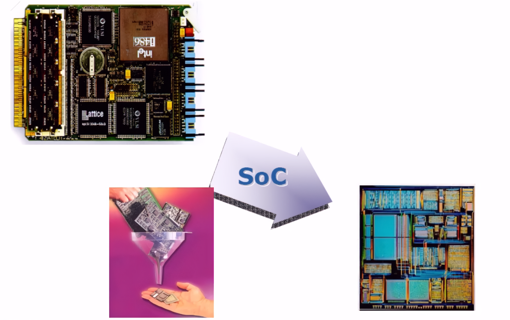
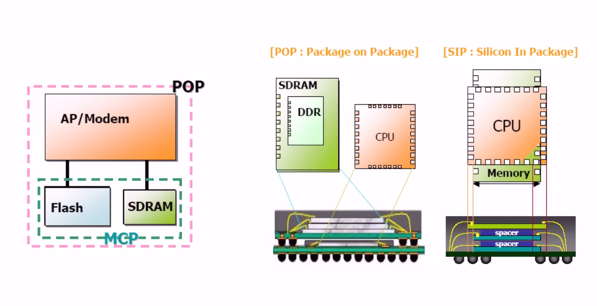
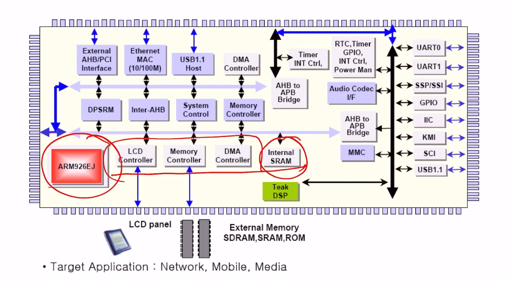
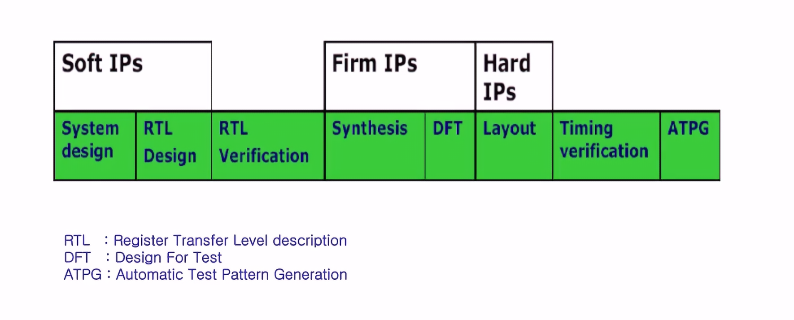
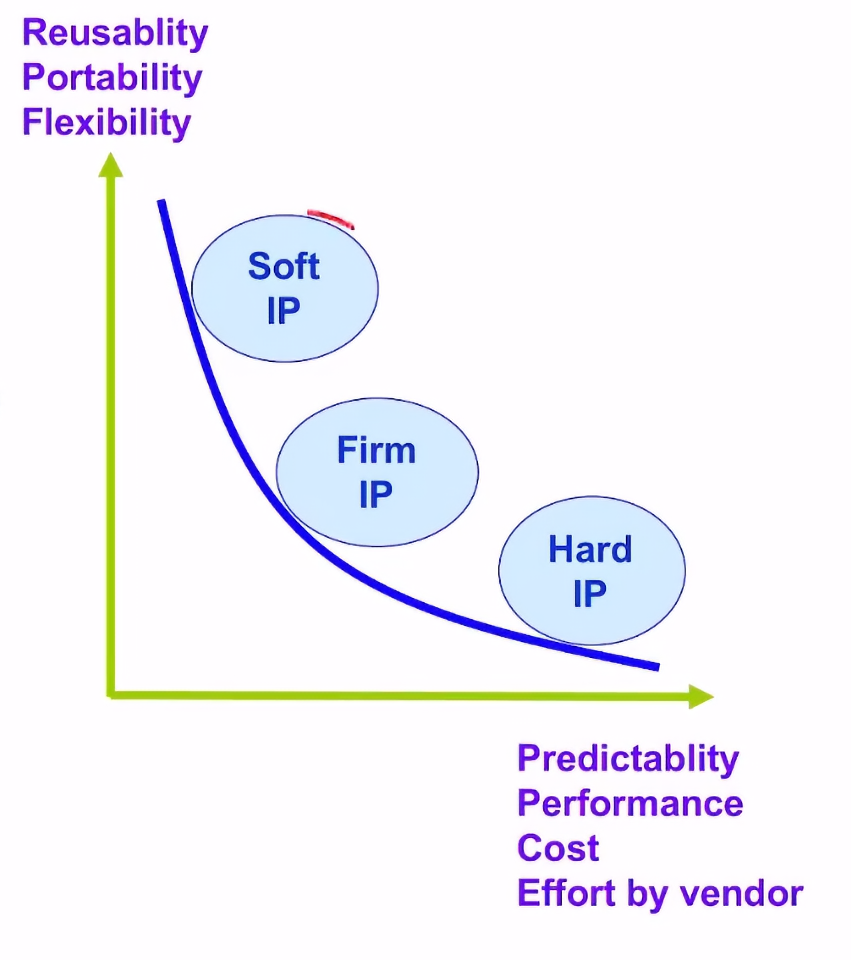
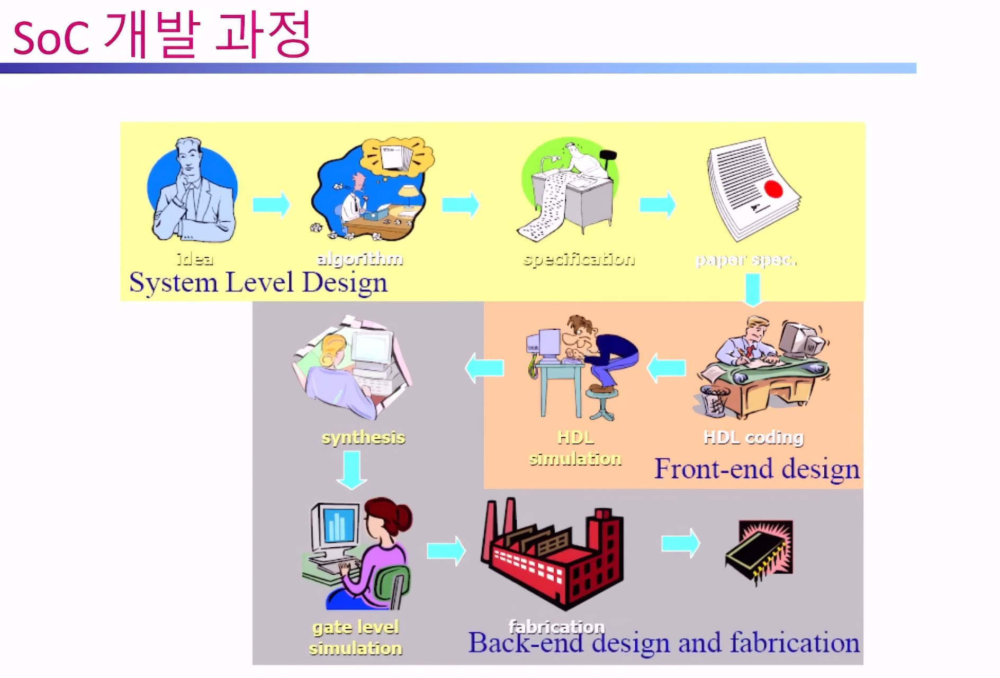
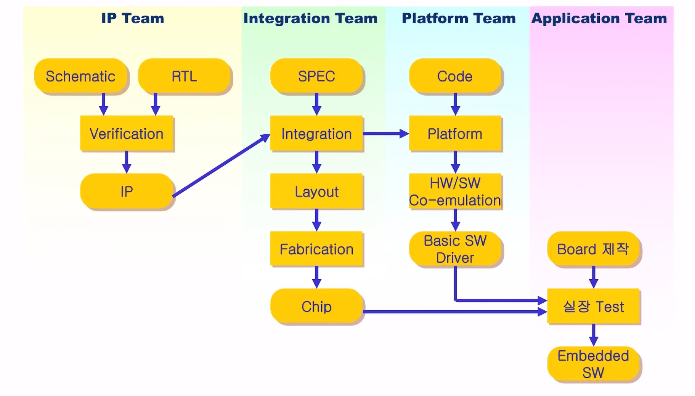

# Soc(System on a Chip) 개념
## 1. Chip이란
- 반도체 웨이퍼에서 잘려나온 작은 실리콘 조각을 의미
    - 패키징 하면 chip
    - 패키징 안하면 die
- 이 안에 **집적 회로**(**IC**:Integrated Circuit)을 담고 있어 반도체 소자 하나로도 불림.
### 1. 정의
> 수많은 트랜지스터, 저항, 배선등을 미세공정으로 형성해 **특정한 전자 기능**을 수행하는 실리콘 단위 소자
### 2. 예시
- CPU
- GPU
- Memory
- ㆍㆍㆍ
## 2. Soc 기본 개념
### 1.기본 개념
> 하나의 칩에 구동 가능한 **시스템**이 **내장**되어 있음을 말함
>> ex : Processor, DSP, Analog core, ROM, RAM, Controller, Peripheral 등
## 3. 장단점
### 1. 장점
* 고성능, 저전력, 안정성
* 시스템 개발 기간 및 노력의 단축
* 조립의 용이성
* 제품의 폼팩터가 작아짐
* 가격 경쟁력
### 2. 단점
* 다양한 기능을 집적하므로 개발 기간이 김
    * Intellectual Property(IP)나 Platform 사용
* 설계 검증 시간이 증가
    * 전문 검증 tool 사용 및 소프트웨어와의 통합 검증
    *  Universal Verification Methodology(UVM)과 같은 프레임워크

## 3.관련 용어

### 1. System on Chip(SoC)
> **하나의 칩**에 **여러 기능**이 들어간 형태

### 2. System in Package(SiP)
> 여러개의 **칩**을 **하나의 패키지**에 들어간 형태

### 3. Silicon In Package(SIP)
> 여러개의 **다이**을 **하나의 패키지**에 **적층한** 형태

### 4. Package on Package(PoP)
> 패키지들을 **적층한** 형태

### 5. 레지스터 전송 수준(RTL : Register Trasfer Level)

## 4. 개발 기법
### 1. Platform
> 일정한 응용분야를 위해 개발된 안정되고 기본적인 구조
- SW 와 HW의 수정을 통해 원하는 제품개발이 가능
- 제품 개발 성공 가능성이 높으며 개발 노력이 절감됨
- 수정 및 확장이 쉬워 제품 개발 기간 단축
- 다양한 응용분야에 맞추어 최적의 platform을 선택해야 함

### 2. Intellectual Property(IP)
> **재이용** 가능한 SW모듈이나 HW, 전자회로의 기능블록
- 대부분의 IP를 재사용하고 일부만 설계
- 필요인력, 개발기간 감소

#### IP를 설계시 중점
- 여러 응용이 가능하게 **configuration** 가능해야함
- 표준화된 **인터페이스**에 연결 가능해야함
- 다양한 **시뮬레이터**에서 시뮬레이션이 가능해야함
- 다양한 공정에서 사용 가능해야함
- 칩에 집적되어도 독립적 검증 가능해야함
- 실제 실행 환경에서도 테스트해 검증이 이루어 져야함
- 문서가 잘 제작되어 있어 적용시 문제 없어야함

#### 분류

##### soft IP
##### hard IP
##### firm IP

#### 예시
##### RISC
> ARM, MIPS, SPARC ㆍㆍㆍ
##### DSP & CISC
> TI, x86 ㆍㆍㆍ
##### Interfaces
> USB, PCI, UART, PCMCIA, Bluetooth ㆍㆍㆍ
##### Networking & Encryptions
> ATM switch, Erhernet, DES, AED ㆍㆍㆍ
##### Multimedia
> JEPG coder, MPEG decoder, H.264, 2D/3D ㆍㆍㆍ
##### Analog Cores
> ADC, DAC, PLL, CODECㆍㆍㆍ
##### Memory Cores
> DRAM core, SRAM, FLASH ㆍㆍㆍ

## 5. Soc설계 HW/SW 고려사항
1. 응용 분야에 따라 우선 순위 결정
    - 저전력
    - 성능
    - 크기
    - 가격
    - 개발기간
    - 호환여부
    - 사용툴
    - 재사용성
    - 사업성
    - 기술지원 여부
2. 임베디드 소프트웨어의 비중이 큼
> 소프트 웨어와 동시에 개발하여야 최적화가 가능
3. chip 디자인시 고려사항
    - 설계 능력, 보유 IP
    - 개발 기간
    - 소모 전력
    - 개발 툴
    - 파운더리 신뢰도
    - 공정 기술
    - 개발비, 단가, 생산수량
    - 패키지(형태)
    - 수율
    - 테스트 능력 및 장비
    - 기술 지원
## 6. SoC 개발 과정

## n. 용어 
1. Processor
2. DSP
3. Analog core
4. ROM
5. RAM
6. Controller
7. Peripheral
8. CDMA
9. AP(Application Processor)
10. BUS
11. RTL
12. HDL
13. Layout
> 여러 기업에서 만든 버스들이 있고 근래에 주로 쓰이고 있는 ARM사의 AMBA를 주로 채택

