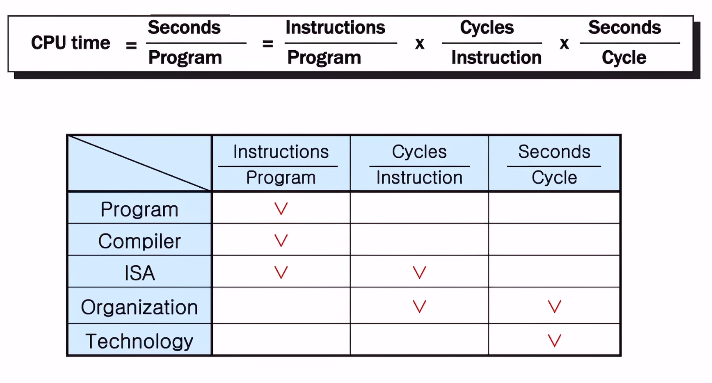
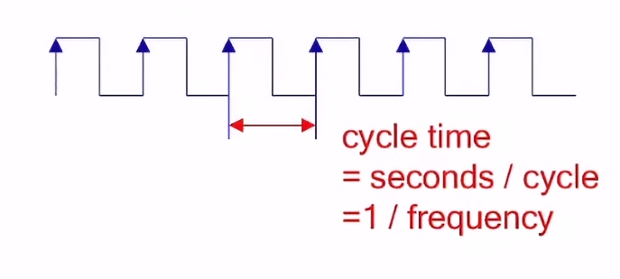
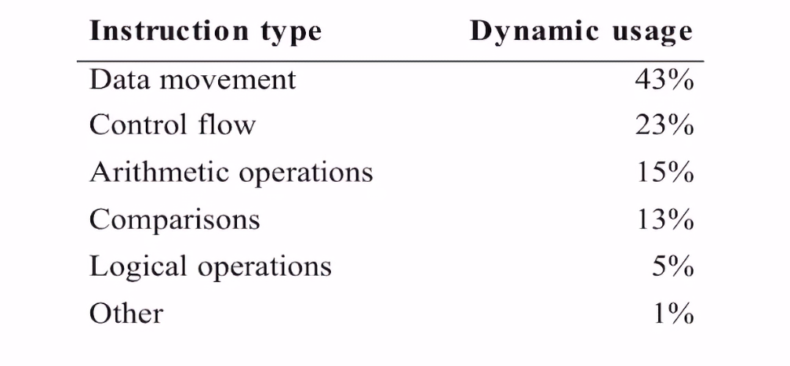
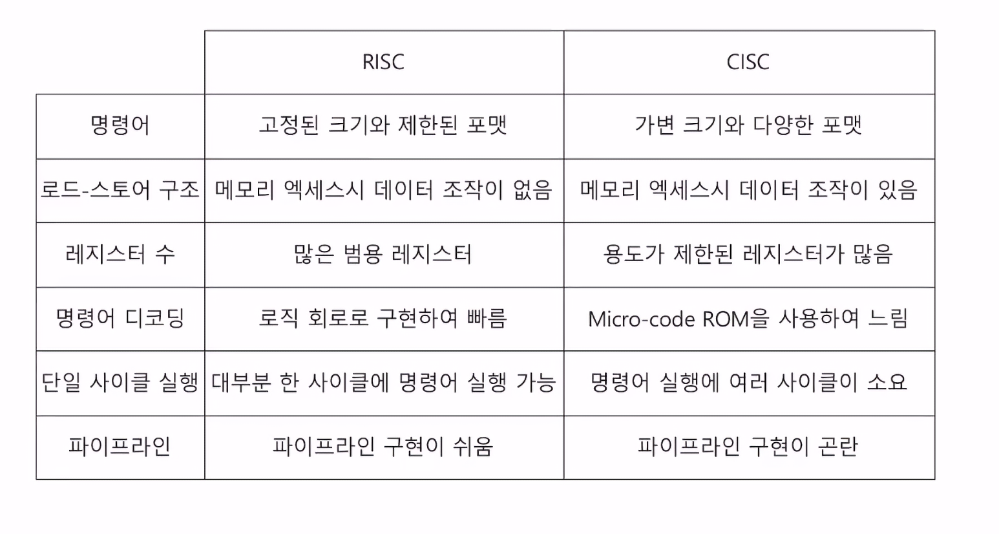
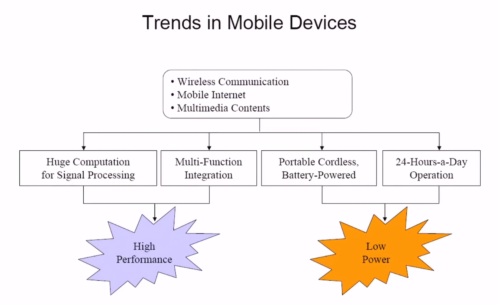
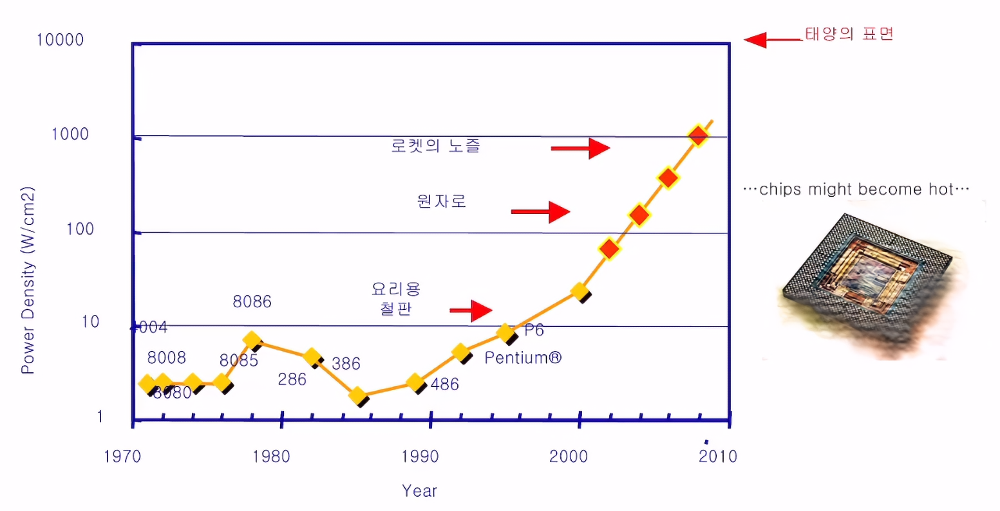
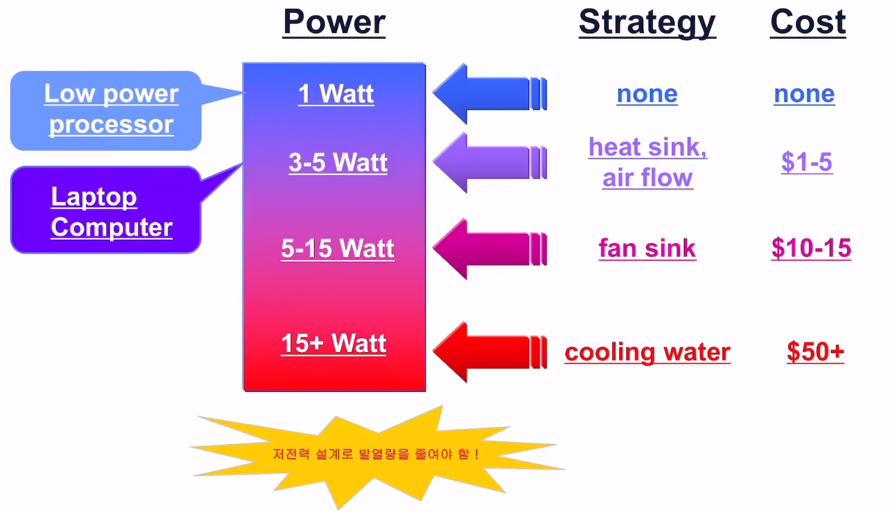
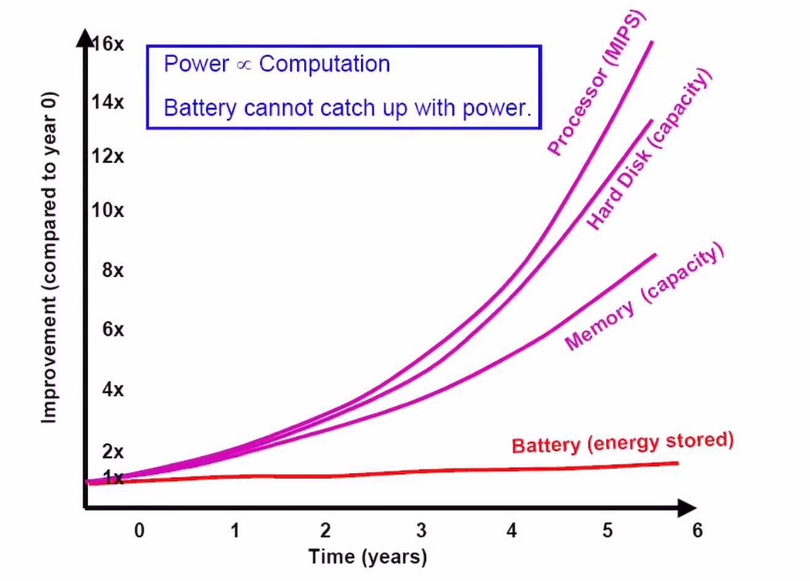
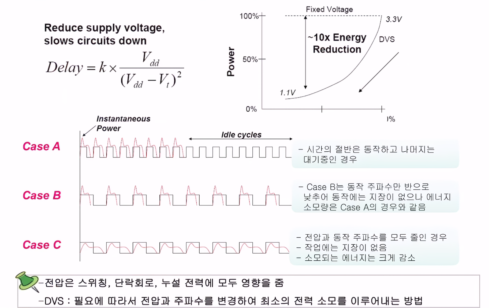
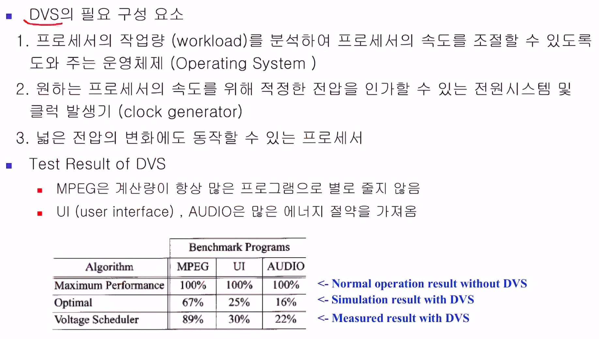

# 프로세서 성능 및 저전력 설계
## 컴퓨터 구조

### Instruction Set Architecure(ISA)
> HW의 자원을 이용할 수 있는 일종의 명령어 셋
> HW와 SW을 연결 시켜주는 인터페이스라고 이해하면됨

#### 주된 형태
- 4addr 형식 : function / op1 / op2 / dest / next i 
- 3addr 형식 : function / op1 / op2 / dest 
- 2addr 형식 : function / op1 / dest
- 1addr 형식 : function / op1
- 0addr 형식 : function

#### 명령어 타입
- data processing : 논리, 사칙 연산과 같은 명령어
- data movement : 데이터의 이동 load나 store 가틍ㄴ
- control flow : 실행준서 변경하는 명령어 jump, return 같은
- special : 프로세서의 상태를 바꾸는 명령어 ex 사용자 모드 / 관리자모드, arm 명령어 모드 / thumb 명령어 모드

#### CPU의 성능
> CPU의 성능은 CPU time에 반비례
> Performance = 1 / CPU time

#### Complex Instruction Set Computer(CISC)
> 과거의 방식
> ISA에 **복합** 명령어들을 추가하는 방향으로 발전
> 내부적으로 명령어를 **micro-code(아직 이해안됨)**로 분해해 실행
> 다양한 어드레스 모드 지원

##### 장점
- 하나의 명령어로 강력한 기능 구현 가능
- 고급언어의 컴파일이 단순함
- 컴파일된 프로그램의 크기가 작음

##### 단점
- 명령어의 사용 빈도수가 고려되지 않음
- 명령어의 실행시간을 고려하지 않음
- 공정기술의 발달로 더많은 회로의 집적이 가능해도 명령어 추가에만 소모되어 다른 기능을 넣을 공간이 부족함

##### RISC으로 가는 이유

사용되는 대부분의 명령어가 단순한 명령어들이기 때문에 복잡하게 구현할 필요가 없다.
-> 비교적 낮은 빈도의 복합명령어 사용
> 단순한 명령어들로만 구현해 CPI와 cycle time을 개선하는 방향이 성능 향상에 보다 도움됨

#### Reduce Instruction Set Computer(RISC)
> 시작 단계인 RISC1 에선 32bit cpu, 32bit 명령어 포맷, 31 명령어, 3가지 어드레스 모드로만 구현

- **고정된 크기**와 제한된 포맷의 명령어 세트(CISC는 가변적 크기와 다양한 포맷으로 이루어짐)
- load-store 방식 : 레지스터와 메모리간 데이터 이동 명령어 즉 단순 전달만을 실행
- 많은 범용 레지스터들로 자유로이 프로그래밍 가능(CISC는 용도가 정해져있는게 많아서 범용 레지스터로 이용이 제한적임.)
- 명령어 해석기가 HW적으로 만들어짐 -> SW(microcode rom으로 구현된)적으로 만들어진 CISC에 비해빠름
- 명령어가 단순하므로 대부분 한 사이클에 실행 가능 CISC에는 보통 많은 사이클 소요
- 파이프라인 적용이 쉬움

##### 장점
- CPU의 코어가 작아짐으로 다른 기능을 하나의 칩에 집적가능 ex(캐시, MMU, FPU)
- 디자인이 단순해 개발기간이 짧아지고 오류도 상대적으로 적음
- 단순한 명령어들이 빠르게 실행가능 -> 높은 성능 가능

##### 단점
- code density가 CISC에 비해 좋지않음(즉 컴파일 후 파일크기가 CISC에 비해 큼)

### 저전력 설계

#### 해야하는 이유
- 코스트를 낮추기 위함
- 부품간 성능 향상의 갭
- 사용환경
- 신뢰성

#### 전력이 소모되는 형태
##### Dynamic Power
> **Swtithing Power** 또는 **Capactitive Power**라고도 불림

칩이 동작할 때 소모되는 전력을 의미함
회로가 **0 -> 1, 1 -> 0으로 스위칭** 되기 때문에 스위칭 파워라고 불리고
스위칭 할때 **캐패시터를 충방전** 시키기 때문에 캐패시티브 파워라고도 불림

##### Static Power
> **Leakage Power**라고도 불림
> 칩이 동작하지 않을 때 소모되는 전력

###### 종류
- Draing junction leakage(Reverse-biased diode) : 매우 적기에 크게 신경은 안써도 되는 부분
  - 다이오드는 전류의 방향을 일방적인 방향으로 만들어주는데 미세하게 반대방향으로 들어가기는함
- Sub-threshold current 

- gate oxide leakage
외에도 종류는 좀 있어보이는데 우리입장에서 크게 건드릴 이유가 없음

##### Short-Circuit Power
> 회로에서 p형, n형 반도체가 쓰이는 경우가 많은데
> 이때 p형 n형이 **동시에 단락**되는 그 구간이 존재 할 수 밖에 없음
> 그 때 소모 되는 전력

큰 load 캐패시터를 사용하면 비교적 적어짐

##### 공정에 따른 차이

공정에 따라서도 비율이 바뀜

#### 소모 전력을 줄일 수 있는 방식

##### Dynamic Vloatge Scaling(DVS)

##### Power Managerment
