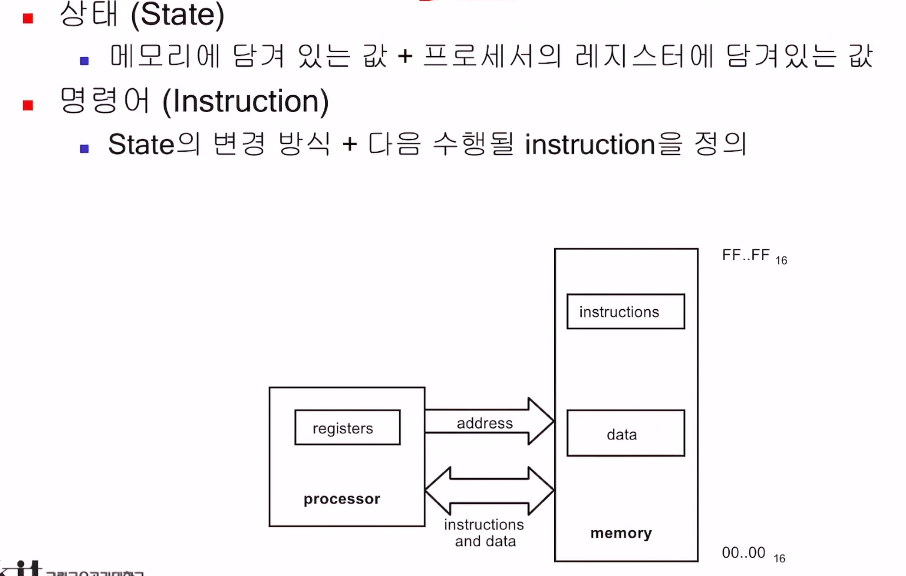
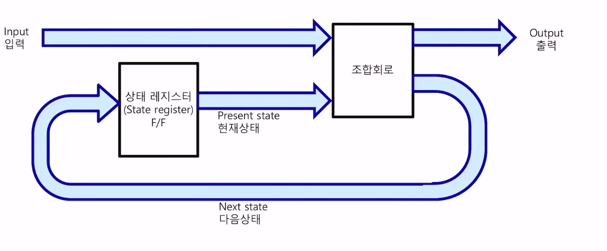
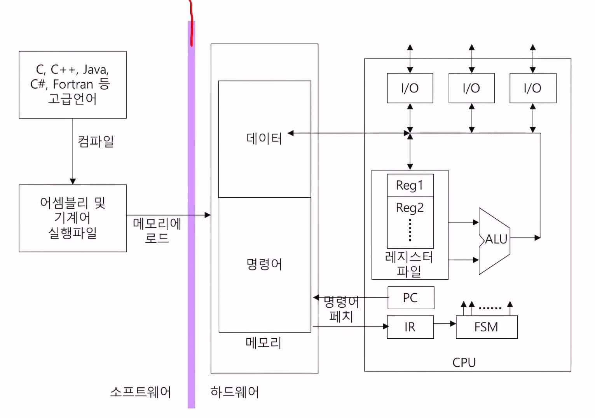
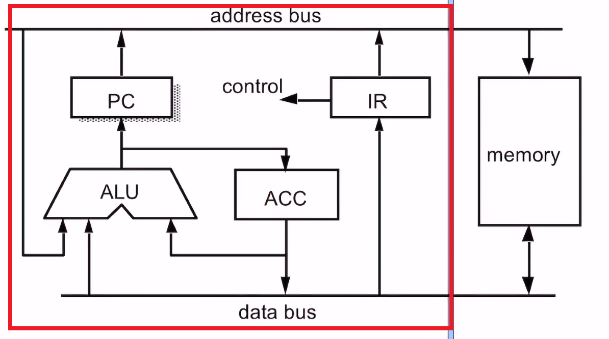
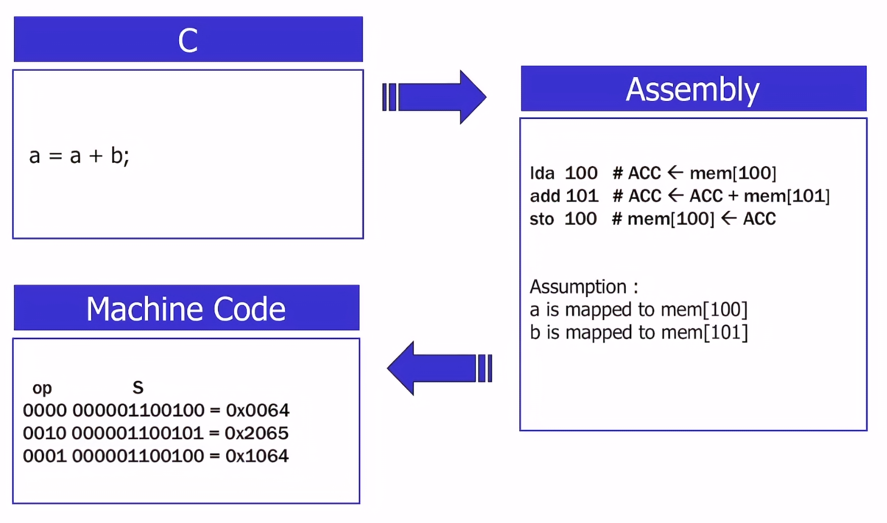
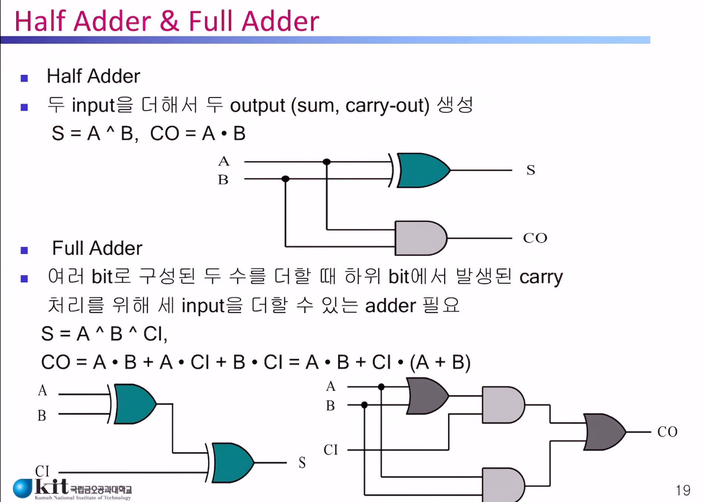
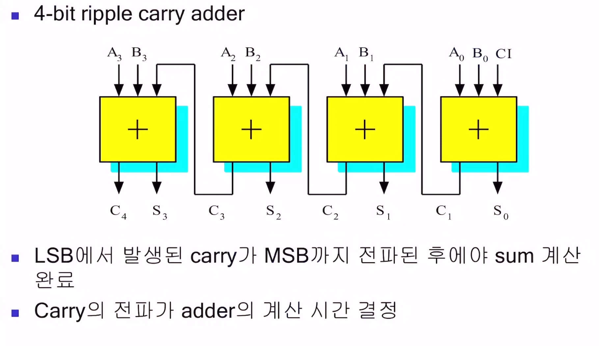

# 프로세서
> 현재의 범용 컴퓨터는 STORED-PROGRAM COMPUTER 개념을 채용중
> processor 혹은 processing unit로 주로 불리는 **회로**이다.
> 메모리에 있는 **명령어(instructuin)** 을 수행하는 한정된 **상태(state)** 를 갖는 **자동 장치(automaton)**

- 근 50여년간 동작 원리는 크게 바뀌지 않음
- 진공관 -> 트랜지스터 -> 집적회로 -> 초대규모집적회로(흔히 우리가 보는 칩형태)

> 다만 컴퓨터 구조나 구성에 있어서는 변화가 존재

ex
- 가상 메모리, 투명 캐시 메모리, 파이프라인, RISC, super-scalar, VLIW, 멀티 스레드 등

## 프로세서 구조(Architecture)
> 프로세서를 보는 사용자 관점

ex
-  명령어 셋, 불가시 레지스터 메모리 관리, 예외처리 등

### Program Counter(PC)
> **실행할 명령어**의 **주소값**을 저장하는 **레지스터**
> 운영체제에서 **문맥 교환**이 발생할 때 다음에 실행할 명령어 주소(주기억 장치에서의)를 가지고 있는 그거 마즘

### Instruction Register(IR)
> 실행 하기위해 FETCH할 명령어를 올리는 **레지스터**
> LOAD와 FETCH의 차이점은 FETCH는 **명령어**을 LOAD는 **데이터**를 가져오는 것과 
> 저장 위치의 차이가 있음 LOAD는 대체로 범용 레지스터에 저장됨

### Accumulator(ACC)
> 누산기 라고도 불리고 ALU의 연산 결과가 저장되는 레지스터 였지만
> 과거엔 ACC가 유일한 범용 레지스터 였고(암묵적)
> 현대에선 범용 레지스터 집합 중 하나일뿐임 다만 주로 연산의 결과값을 저장하는 역할을 함(명시적)

## 프로세서 구성(Organization)
> 사용자는 볼 수 없고 설계자만 볼 수 있는 구현 방법 

ex
- 파이프라인 구조, 투명 캐시, 테이블-워킹, TLB(translation look-aside buffer)

## MU0 : 16-bit processor
- 16 bit instruction
- 16 bit data
- 12 bit address memory space(12 bits addr × 16 bits data = 8Kbytes)

### 명령어 구조
- 4 bit op code (명령어)
- 12 bit perand (데이터)

#### 구성

- Arithmetic-logic unit(ALU) : 산술 연산 장치
- Instruction decoder & control logic : IR에 저장된 값을 해석 및 처리하는 부분 
- MUX, BUFFER 등등

#### 동작 예시

### 디자인
> 프로세서 유닛은 크게 두가지로 구성됨
- datapath : 명령어나 데이터의 흐름을 처리하는 부분
  - ACC, PC, ALU, IR, MUX, 3-state buffer 등등
- control logic : datapath를 제어하는 신호들을 발생시키는 회로
  - 명령어 디코더와 같은 신호발생기를 의미
  - FSM or ROM등으로 구현

#### datapath 디자인
> MU0에서 사용하는 메모리의 read / write엑세스는 항상 1사이클이 필요
- 2 사이클 명령어 : LDA, STO, ADD, SUB
- 1 사이클 명령어 : JMP, JGE, JNE, STP

##### 가산기
> ALU의 기반중 하나

## Synchronized reset generation

왜 비동기가 안좋은가 -> 메타 스테빌리티를 만듦
신호가 Unknown인것과 메타 스테빌리티의 차이점은
Unknown은 H or L로만 깔끔하게 나눠지는 반면 ->SW적으로 확실하게 떨어지는 형태
메타 스테빌리티는 신호자체가 불확실한 전압레벨에 머무르는 형태를 의미. -> HW적으로 불안정한 상태

## 추가 자료

## datapath operation
### 기본적 순서
1. 초기화 : 명령어는 0번지 주소부터 시작하도록 초기화.
2. 실행 : IR에 있는 명령어를 실행 (1Cycle 명령어들은 의미가 없는듯.)
3. 패치 : PC에 저장된 메모리 주소에 있는 명령어를 IR에 올리기

> datapath의 동작은(모든 레지스터와 메모리들은) falling edge clock에 맞춰짐
> f/f은 rising edge임

## 해당 단원에서 추가로 언급한 것들

## 알아볼 단어들
- 가시 레지스터
- 불가시 레지스터
- RISC
- 슈퍼 스칼라
- VLIW
- 스크래치드 캐시